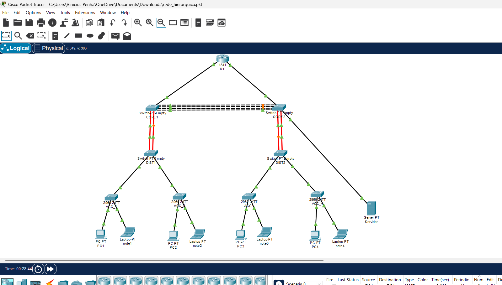
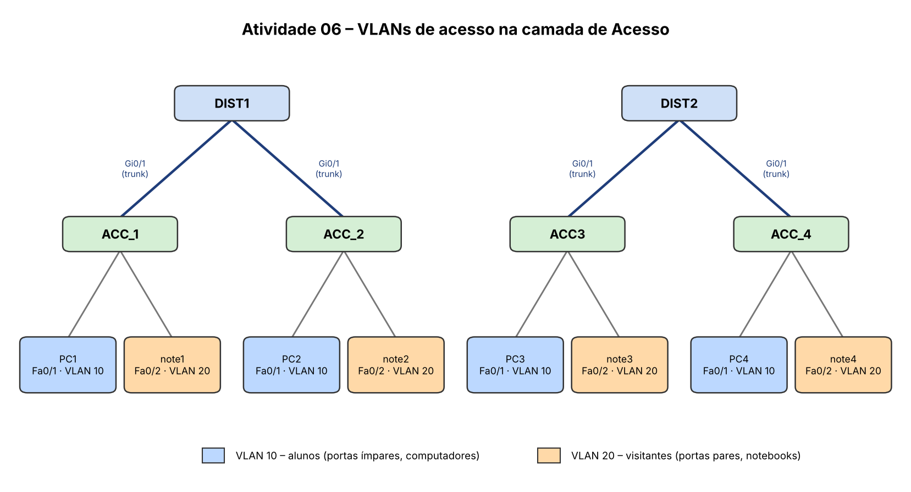
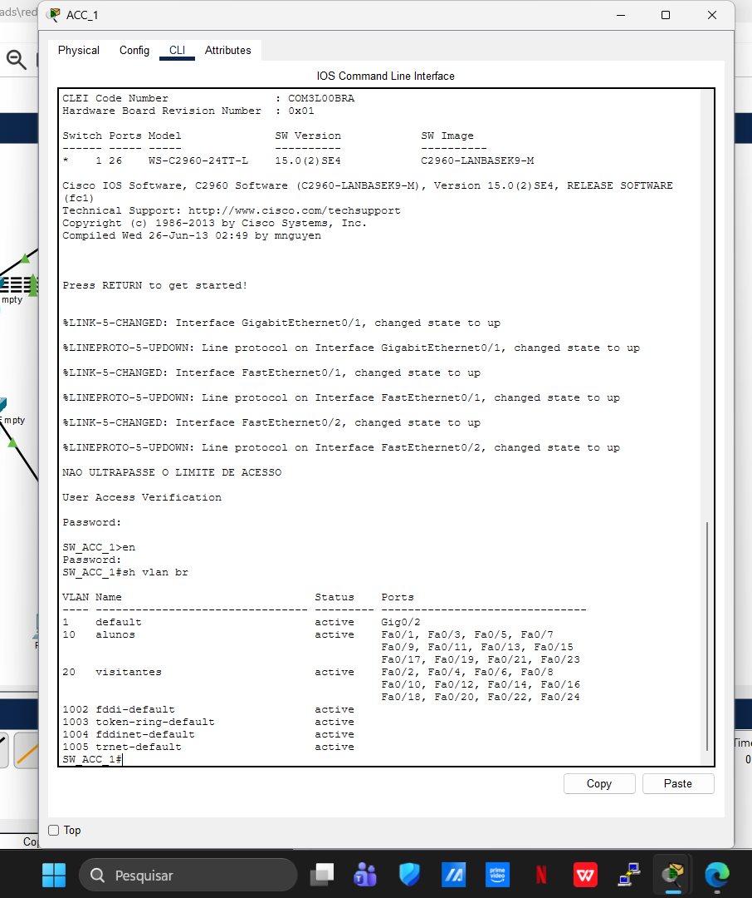
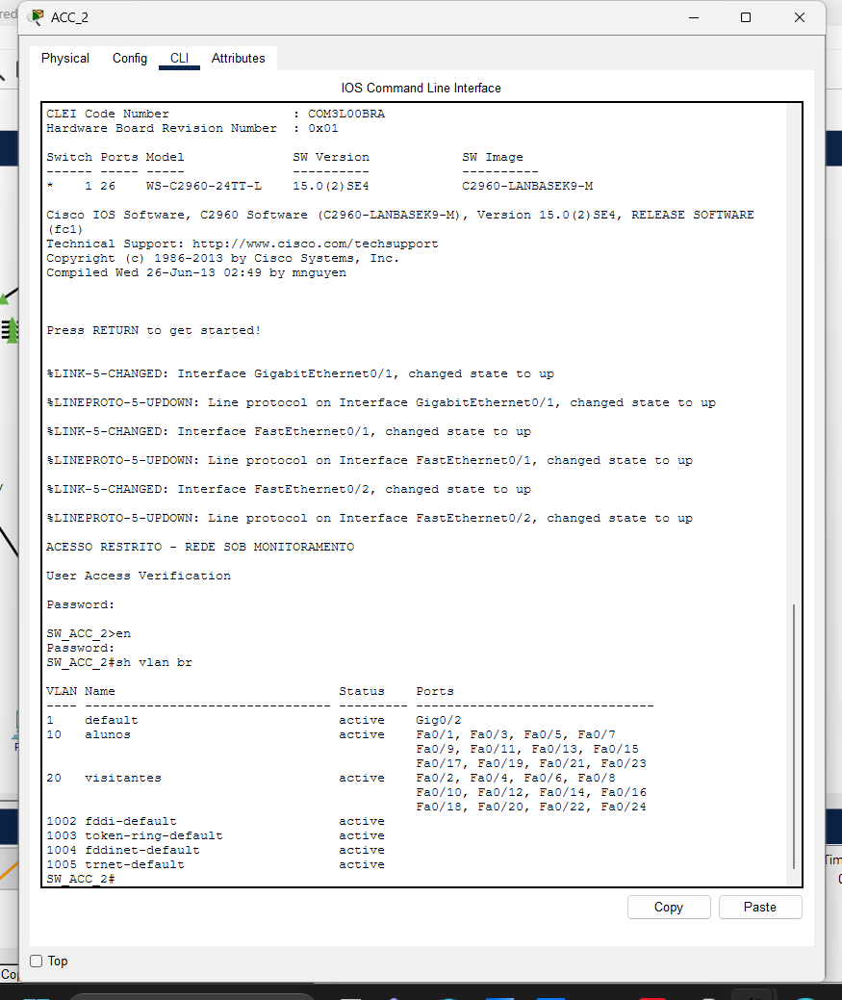
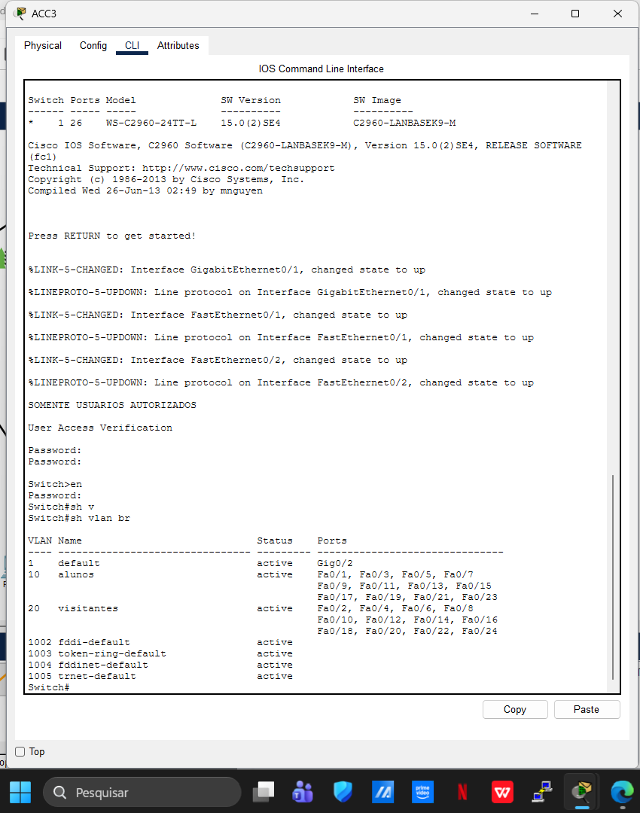
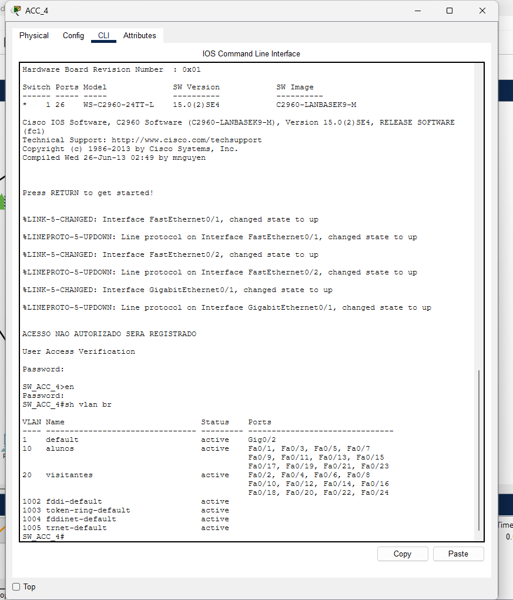

# Atividade Prática 06 – VLANs de Acesso em Ambiente Hierárquico

Simulação no **Cisco Packet Tracer** de uma rede hierárquica (Núcleo, Distribuição e Acesso) com duas VLANs configuradas nos switches da **camada de Acesso**.

## 1. Objetivo

- Criar as VLANs 10 e 20 nos quatro switches de acesso (ACC_1, ACC_2, ACC3 e ACC_4).
- **VLAN 10 (Alunos):** portas **ímpares**, onde ficam os computadores.
- **VLAN 20 (Visitantes):** portas **pares**, onde ficam os notebooks.
- O escopo não inclui as portas de interligação entre switches (trunks), que são tratadas em outra atividade.

## 2. Topologia



Mapa das portas de acesso e das VLANs:



| Camada | Dispositivos |
|---|---|
| Roteador | R1 (Cisco 1841) |
| Núcleo | CORE1, CORE2 |
| Distribuição | DIST1, DIST2 |
| Acesso | ACC_1 e ACC_2 (DIST1); ACC3 e ACC_4 (DIST2) – Cisco 2960-24TT |
| Estações | PC1–PC4 e note1–note4, um PC e um notebook por switch de acesso |

## 3. Fundamentação

- **VLAN (Virtual LAN):** divide um switch em redes lógicas separadas (domínios de broadcast distintos). Dispositivos em VLANs diferentes não se comunicam na camada 2, mesmo estando no mesmo switch.
- **Identificação:** cada VLAN tem um **ID** (1 a 4094) e pode receber um **nome** descritivo.
- **Porta de acesso (access):** pertence a **uma única VLAN** e entrega os quadros sem tag ao dispositivo final. É configurada com `switchport mode access` e `switchport access vlan <id>`.
- **Porta de interligação (trunk):** transporta várias VLANs entre switches. Não faz parte desta atividade; a `Gig0/1` de cada switch de acesso é o uplink e foi tratada à parte.

## 4. VLANs

| ID | Nome | Portas | Dispositivos |
|---|---|---|---|
| 10 | alunos | Fa0/1, 3, 5, 7, 9, 11, 13, 15, 17, 19, 21, 23 (ímpares) | Computadores (PC1–PC4) |
| 20 | visitantes | Fa0/2, 4, 6, 8, 10, 12, 14, 16, 18, 20, 22, 24 (pares) | Notebooks (note1–note4) |
| 1 | default | Gig0/2 | Sem uso |

## 5. Mapeamento das interfaces

Os quatro switches de acesso têm a mesma configuração.

| Switch | Interface | Modo | VLAN | Dispositivo conectado |
|---|---|---|---|---|
| ACC_1 | Fa0/1 | access | 10 | PC1 |
| ACC_1 | Fa0/2 | access | 20 | note1 |
| ACC_2 | Fa0/1 | access | 10 | PC2 |
| ACC_2 | Fa0/2 | access | 20 | note2 |
| ACC3 | Fa0/1 | access | 10 | PC3 |
| ACC3 | Fa0/2 | access | 20 | note3 |
| ACC_4 | Fa0/1 | access | 10 | PC4 |
| ACC_4 | Fa0/2 | access | 20 | note4 |

Demais portas: **ímpares** (Fa0/3 a Fa0/23) na VLAN 10 e **pares** (Fa0/4 a Fa0/24) na VLAN 20, já preparadas para novos dispositivos. A `Gig0/1` é o uplink para a distribuição (trunk) e não aparece no `show vlan brief`, porque portas trunk não são listadas por VLAN.

## 6. Comandos de configuração

Mesma sequência nos quatro switches de acesso (ACC_1, ACC_2, ACC3 e ACC_4).

**Criar e nomear as VLANs**

```
enable
configure terminal
vlan 10
 name alunos
vlan 20
 name visitantes
 exit
```

**Portas ímpares na VLAN 10**

O `interface range` aceita até 5 itens por comando, por isso as portas são divididas em grupos.

```
interface range FastEthernet0/1 , FastEthernet0/3 , FastEthernet0/5 , FastEthernet0/7 , FastEthernet0/9
 switchport mode access
 switchport access vlan 10
 exit
interface range FastEthernet0/11 , FastEthernet0/13 , FastEthernet0/15 , FastEthernet0/17 , FastEthernet0/19
 switchport mode access
 switchport access vlan 10
 exit
interface range FastEthernet0/21 , FastEthernet0/23
 switchport mode access
 switchport access vlan 10
 exit
```

**Portas pares na VLAN 20**

```
interface range FastEthernet0/2 , FastEthernet0/4 , FastEthernet0/6 , FastEthernet0/8 , FastEthernet0/10
 switchport mode access
 switchport access vlan 20
 exit
interface range FastEthernet0/12 , FastEthernet0/14 , FastEthernet0/16 , FastEthernet0/18 , FastEthernet0/20
 switchport mode access
 switchport access vlan 20
 exit
interface range FastEthernet0/22 , FastEthernet0/24
 switchport mode access
 switchport access vlan 20
 exit
```

**Salvar**

```
end
write memory
```

## 7. Validação

Comandos de verificação:

```
show vlan brief
show interfaces FastEthernet0/1 switchport
show interfaces FastEthernet0/2 switchport
```

O `show vlan brief` deve listar a VLAN 10 (alunos) com as portas ímpares e a VLAN 20 (visitantes) com as portas pares, como nos prints abaixo.

**ACC_1**



**ACC_2**



**ACC3**



**ACC_4**


