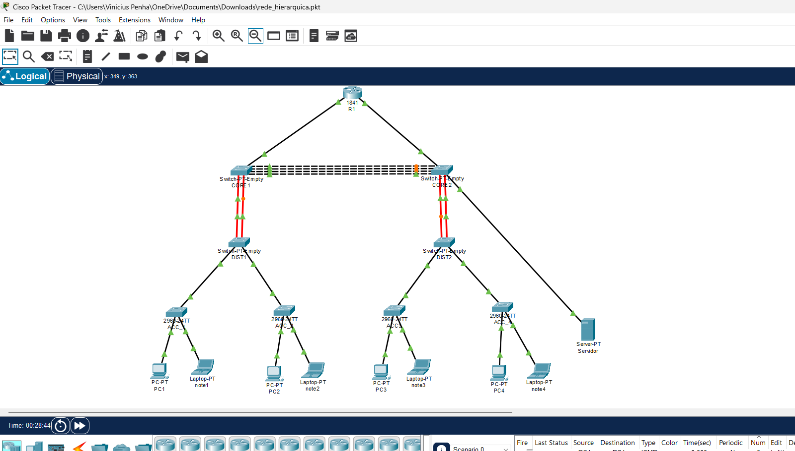
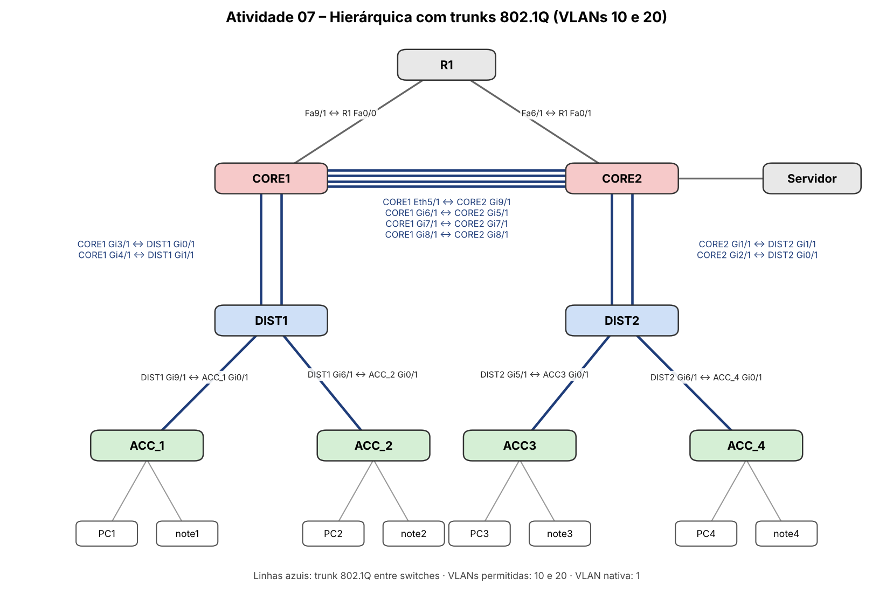
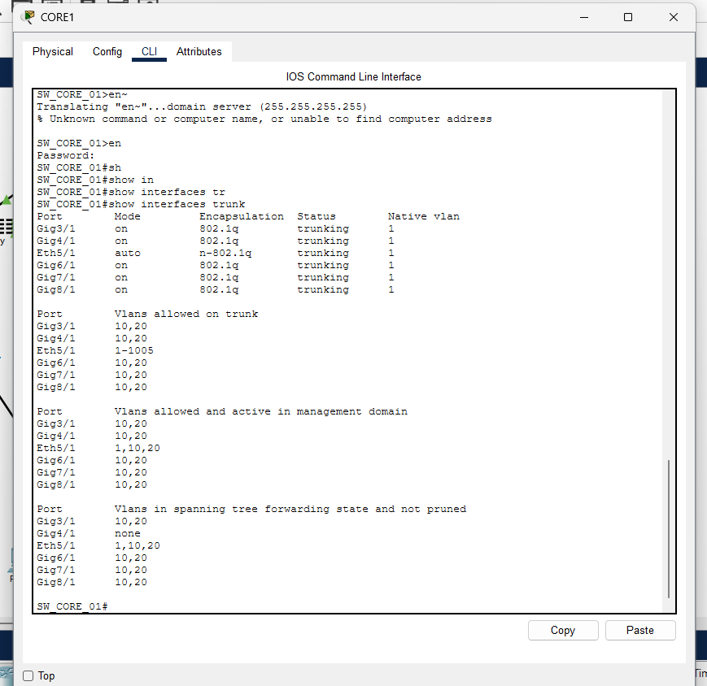
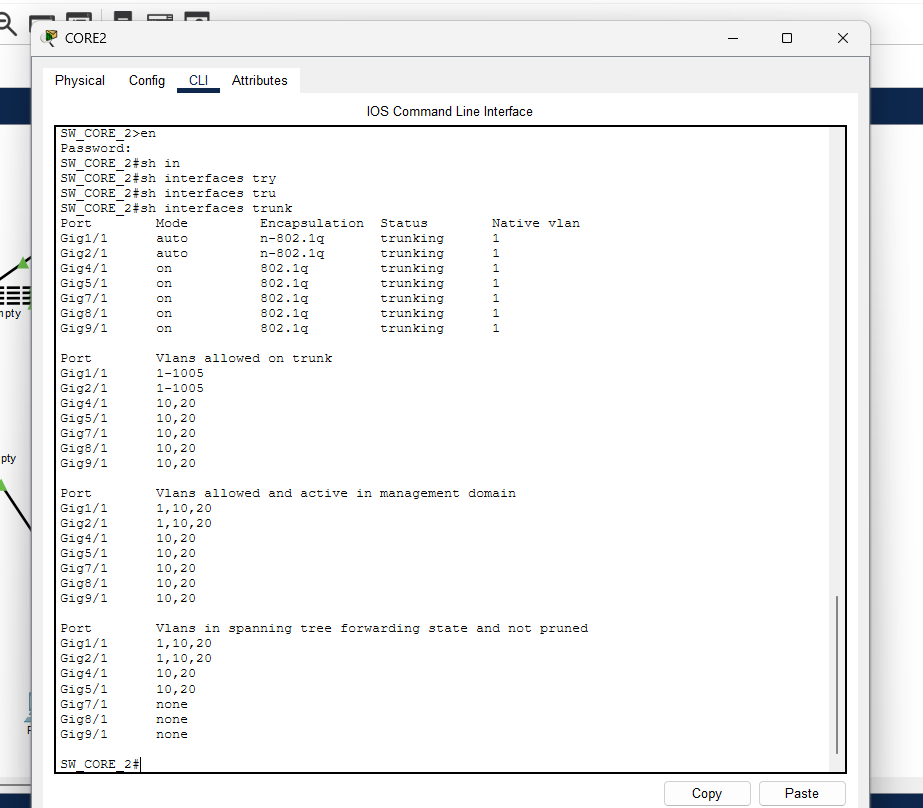
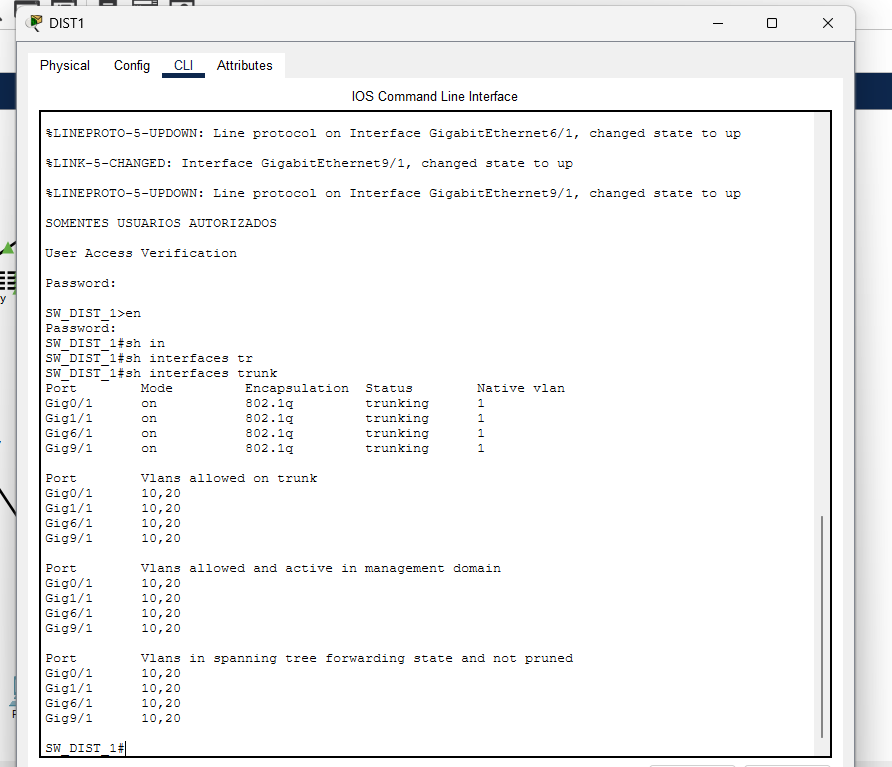
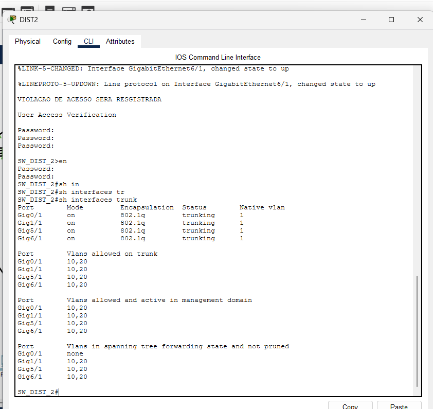
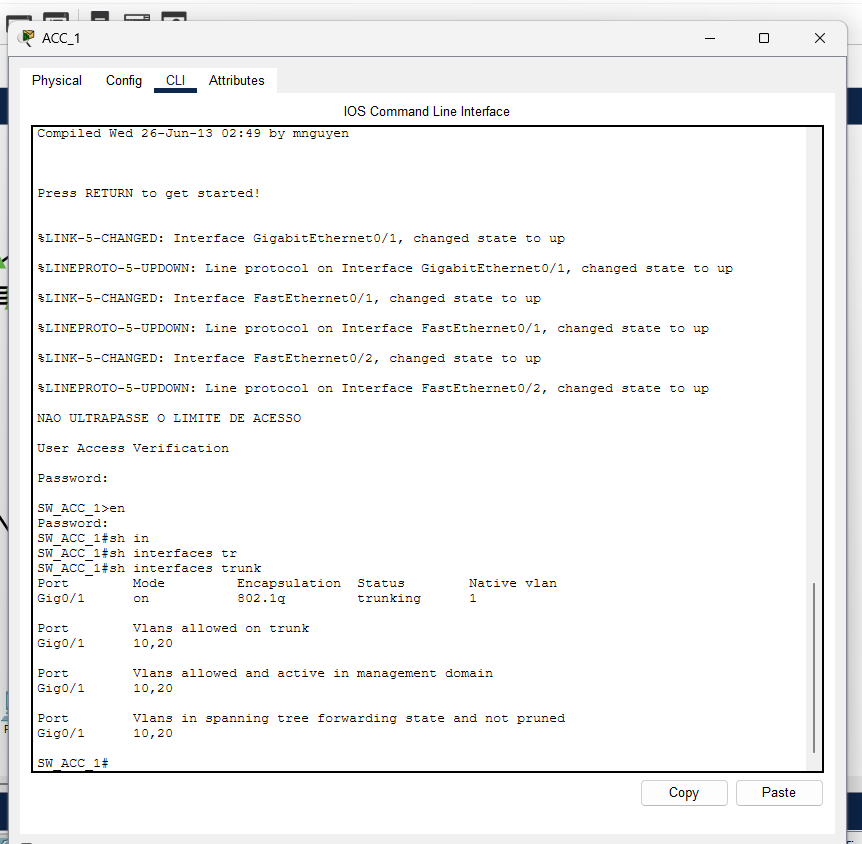
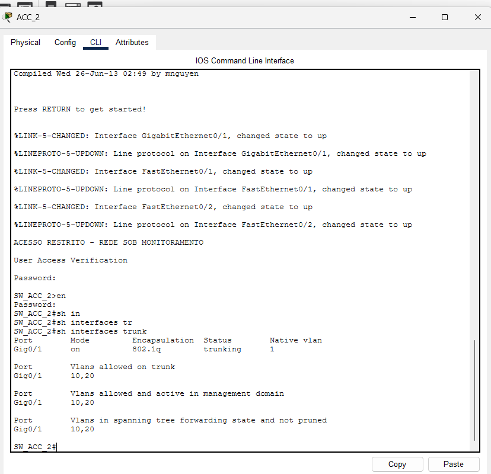
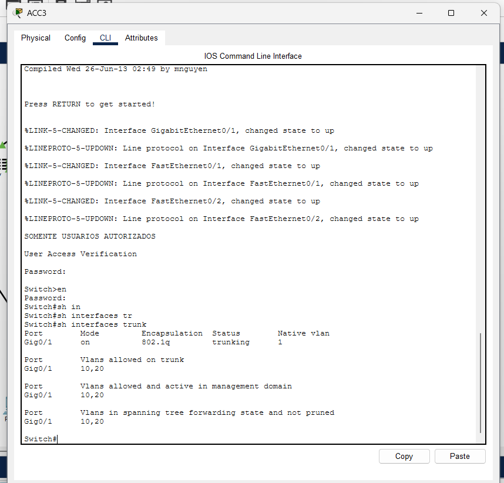
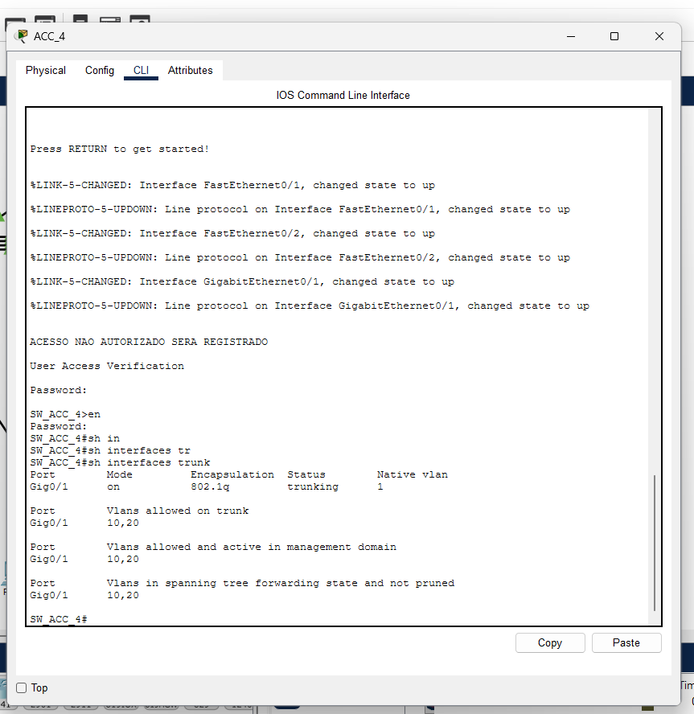

# Atividade Prática 07 – Ambiente Hierárquico com VLANs e Trunk (802.1Q)

Simulação no **Cisco Packet Tracer** de uma rede hierárquica (Núcleo, Distribuição e Acesso) com enlaces **trunk** entre os switches, permitindo o tráfego das VLANs 10 e 20.

## 1. Objetivo

Configurar o modo trunk nas portas de interligação das camadas de **Acesso**, **Distribuição** e **Núcleo**, garantindo que as VLANs 10 (Alunos) e 20 (Visitantes) trafeguem por esses enlaces.

## 2. Topologia



Mapa das interfaces dos enlaces trunk:



| Camada | Dispositivos |
|---|---|
| Roteador | R1 (Cisco 1841) |
| Núcleo | CORE1 (`SW_CORE_01`), CORE2 (`SW_CORE_2`) |
| Distribuição | DIST1 (`SW_DIST_1`), DIST2 (`SW_DIST_2`) |
| Acesso | ACC_1 e ACC_2 (DIST1); ACC3 e ACC_4 (DIST2) – Cisco 2960-24TT |
| Estações | PC1–PC4 e note1–note4 (um PC e um notebook por switch de acesso), Servidor |

## 3. Fundamentação: IEEE 802.1Q

- **Porta trunk:** porta que transporta o tráfego de várias VLANs em um único enlace físico entre switches.
- **Encapsulamento 802.1Q:** o switch insere no quadro Ethernet uma tag de 4 bytes que carrega o ID da VLAN (12 bits, valores 1 a 4094). Assim, o switch do outro lado sabe a qual VLAN o quadro pertence.
- **VLAN nativa (native VLAN):** é a VLAN cujo tráfego trafega **sem tag** no trunk. Por padrão é a VLAN 1, e deve ser a mesma nas duas pontas do enlace.
- **Lista de VLANs permitidas (allowed VLANs):** por padrão o trunk permite todas as VLANs (1–1005). Neste trabalho foi restringida para **10 e 20**, o que reduz tráfego desnecessário.
- **Modo da porta:** `switchport mode trunk` **força** o trunk. Os modos `dynamic auto` e `dynamic desirable` dependem de negociação (DTP) com o vizinho, por isso aqui todas as portas de interligação foram forçadas.

## 4. VLANs

| ID | Nome | Uso |
|---|---|---|
| 10 | Alunos | Estações de alunos |
| 20 | Visitantes | Estações de visitantes |
| 1 | default | VLAN nativa dos trunks |

## 5. Mapeamento das interfaces trunk

Todos os enlaces abaixo usam encapsulamento **802.1q**, VLAN nativa **1** e VLANs permitidas **10,20**.

### Núcleo ↔ Núcleo

| Switch | Interface | Conecta a |
|---|---|---|
| CORE1 | Eth5/1 | CORE2 Gig9/1 |
| CORE1 | Gig6/1 | CORE2 Gig5/1 |
| CORE1 | Gig7/1 | CORE2 Gig7/1 |
| CORE1 | Gig8/1 | CORE2 Gig8/1 |

### Núcleo ↔ Distribuição

| Switch | Interface | Conecta a |
|---|---|---|
| CORE1 | Gig3/1 | DIST1 Gig0/1 |
| CORE1 | Gig4/1 | DIST1 Gig1/1 |
| CORE2 | Gig1/1 | DIST2 Gig1/1 |
| CORE2 | Gig2/1 | DIST2 Gig0/1 |

### Distribuição ↔ Acesso

| Switch | Interface | Conecta a |
|---|---|---|
| DIST1 | Gig9/1 | ACC_1 Gig0/1 |
| DIST1 | Gig6/1 | ACC_2 Gig0/1 |
| DIST2 | Gig5/1 | ACC3 Gig0/1 |
| DIST2 | Gig6/1 | ACC_4 Gig0/1 |

### Roteador

| Switch | Interface | Conecta a |
|---|---|---|
| CORE1 | Fas9/1 | R1 Fas0/0 |
| CORE2 | Fas6/1 | R1 Fas0/1 |

> **Observação:** o mapeamento foi obtido com `show cdp neighbors` em cada switch de núcleo e distribuição.

> **Observação sobre o STP:** em alguns enlaces redundantes, a saída do `show interfaces trunk` mostra `none` em "forwarding state and not pruned". Isso é o Spanning Tree bloqueando um dos caminhos para evitar loops; o trunk continua configurado corretamente.

## 6. Comandos de configuração

Sequência completa por switch. Todas as portas de interligação são forçadas para trunk e restritas às VLANs 10 e 20.

### CORE1 (`SW_CORE_01`)

```
enable
configure terminal
interface range GigabitEthernet3/1 , GigabitEthernet4/1 , GigabitEthernet6/1 , GigabitEthernet7/1 , GigabitEthernet8/1
 switchport mode trunk
 switchport trunk allowed vlan 10,20
 exit
interface Ethernet5/1
 switchport mode trunk
 switchport trunk allowed vlan 10,20
end
write memory
```

### CORE2 (`SW_CORE_2`)

```
enable
configure terminal
interface range GigabitEthernet1/1 , GigabitEthernet2/1 , GigabitEthernet5/1 , GigabitEthernet7/1 , GigabitEthernet8/1 , GigabitEthernet9/1
 switchport mode trunk
 switchport trunk allowed vlan 10,20
end
write memory
```

### DIST1 (`SW_DIST_1`)

```
enable
configure terminal
interface range GigabitEthernet0/1 , GigabitEthernet1/1 , GigabitEthernet6/1 , GigabitEthernet9/1
 switchport mode trunk
 switchport trunk allowed vlan 10,20
end
write memory
```

### DIST2 (`SW_DIST_2`)

```
enable
configure terminal
interface range GigabitEthernet0/1 , GigabitEthernet1/1 , GigabitEthernet5/1 , GigabitEthernet6/1
 switchport mode trunk
 switchport trunk allowed vlan 10,20
end
write memory
```

### Acesso: ACC_1, ACC_2, ACC3 e ACC_4 (mesmos comandos nos quatro)

```
enable
configure terminal
interface GigabitEthernet0/1
 switchport mode trunk
 switchport trunk allowed vlan 10,20
end
write memory
```

## 7. Verificação

Comandos usados em cada switch:

```
show interfaces trunk
show vlan brief
```

A saída mostra, para cada porta trunk, o modo, a encapsulação 802.1q, o status `trunking`, a VLAN nativa 1 e as VLANs permitidas 10 e 20.

**CORE1**



**CORE2**



**DIST1**



**DIST2**



**ACC_1**



**ACC_2**



**ACC3**



**ACC_4**


