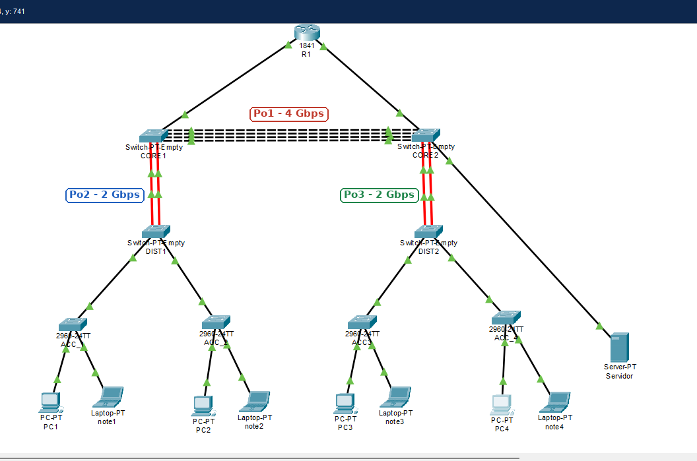
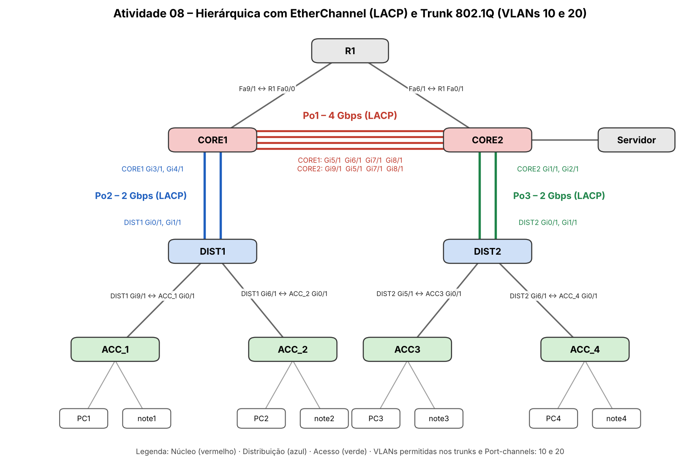
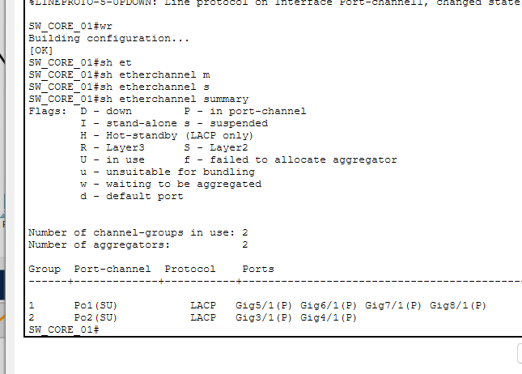
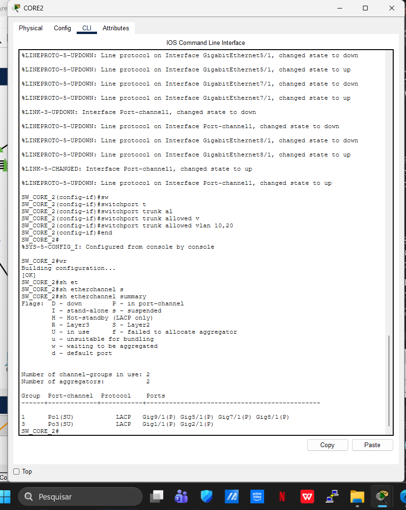
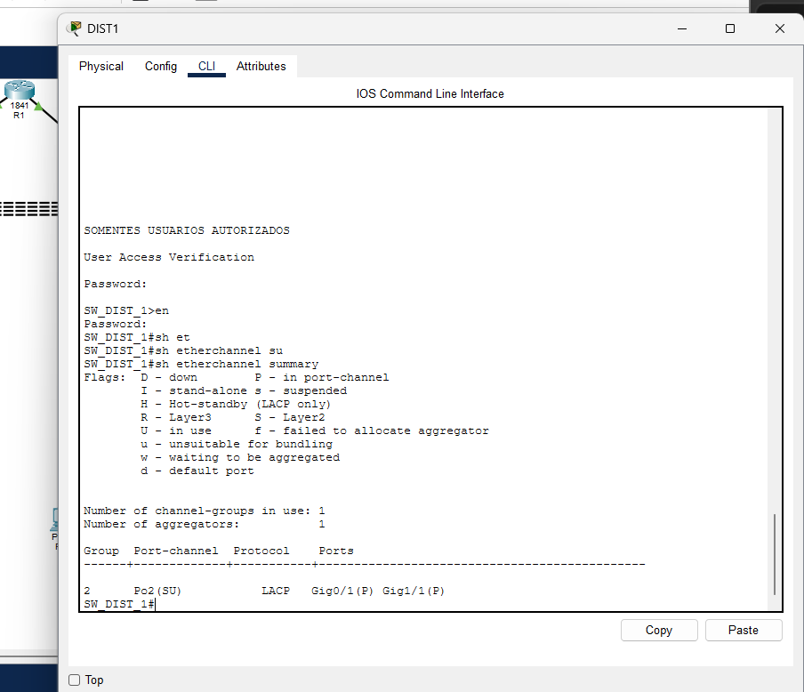
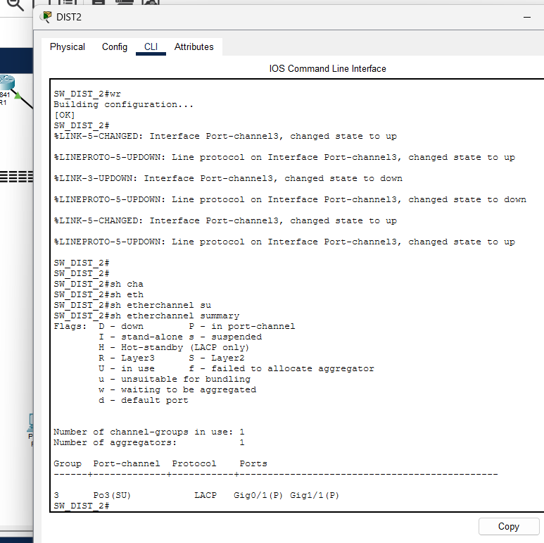
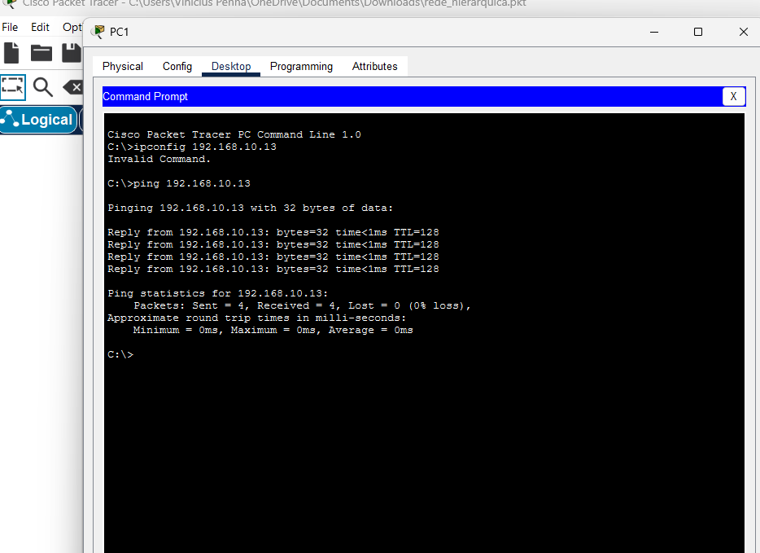

# Atividade Prática 08 – Agregação de Links (EtherChannel/LACP) e Trunk

Simulação no **Cisco Packet Tracer** de uma rede hierárquica (Núcleo, Distribuição e Acesso) com **EtherChannels** entre os switches, configurados como **trunk 802.1Q** para as VLANs 10 e 20.

## 1. Objetivo

- Criar ligações agregadas de **2 Gbps** entre Distribuição e Núcleo e de **4 Gbps** entre os dois switches de Núcleo.
- Configurar os Port-channels em modo trunk.
- Validar a comunicação de ponta a ponta entre ramos opostos da topologia.

## 2. Topologia



Detalhamento das interfaces e dos grupos de agregação:



| Camada | Dispositivos |
|---|---|
| Roteador | R1 (Cisco 1841) |
| Núcleo | CORE1 (`SW_CORE_01`), CORE2 (`SW_CORE_2`) |
| Distribuição | DIST1 (`SW_DIST_1`), DIST2 (`SW_DIST_2`) |
| Acesso | ACC_1 e ACC_2 (DIST1); ACC3 e ACC_4 (DIST2) |

## 3. Fundamentação: agregação de links

- **EtherChannel / Link Aggregation:** agrupa várias portas físicas em um único link lógico (**Port-channel**). A largura de banda soma as portas (4 × 1 Gbps = 4 Gbps) e, se uma porta falhar, o tráfego continua pelas demais.
- **Balanceamento de carga:** o tráfego é distribuído entre as portas por um hash (por exemplo, endereços MAC ou IP de origem e destino). Cada fluxo usa uma porta, e fluxos diferentes se espalham pelo canal.
- **STP:** o Spanning Tree enxerga o Port-channel como **um único enlace**, então os links agregados deixam de ser bloqueados individualmente.
- **Protocolos de negociação:**

| Protocolo | Padrão | Modos |
|---|---|---|
| **LACP** (IEEE 802.3ad) | aberto | `active` / `passive` |
| **PAgP** | proprietário Cisco | `desirable` / `auto` |
| Estático | – | `on` |

Neste trabalho foi usado **LACP em modo `active`** nas duas pontas.

- **Requisito:** as portas de um mesmo canal precisam ter a mesma velocidade, duplex e configuração de trunk/VLANs.

## 4. VLANs

| ID | Nome | Uso |
|---|---|---|
| 10 | Alunos | Estações de alunos |
| 20 | Visitantes | Estações de visitantes |

VLANs permitidas nos trunks e Port-channels: **10 e 20**. VLAN nativa: **1**.

## 5. Port-channels

| Port-channel | Entre | Grupo | Protocolo | Banda | Modo |
|---|---|---|---|---|---|
| Po1 | CORE1 ↔ CORE2 | 1 | LACP (`active`) | 4 Gbps | trunk 10,20 |
| Po2 | DIST1 ↔ CORE1 | 2 | LACP (`active`) | 2 Gbps | trunk 10,20 |
| Po3 | DIST2 ↔ CORE2 | 3 | LACP (`active`) | 2 Gbps | trunk 10,20 |

## 6. Mapeamento das interfaces

### Interfaces físicas dos canais

| Port-channel | Switch | Interface | Conecta a |
|---|---|---|---|
| Po1 | CORE1 | Gig5/1 | CORE2 Gig9/1 |
| Po1 | CORE1 | Gig6/1 | CORE2 Gig5/1 |
| Po1 | CORE1 | Gig7/1 | CORE2 Gig7/1 |
| Po1 | CORE1 | Gig8/1 | CORE2 Gig8/1 |
| Po2 | CORE1 | Gig3/1 | DIST1 Gig0/1 |
| Po2 | CORE1 | Gig4/1 | DIST1 Gig1/1 |
| Po2 | DIST1 | Gig0/1 | CORE1 Gig3/1 |
| Po2 | DIST1 | Gig1/1 | CORE1 Gig4/1 |
| Po3 | CORE2 | Gig1/1 | DIST2 Gig1/1 |
| Po3 | CORE2 | Gig2/1 | DIST2 Gig0/1 |
| Po3 | DIST2 | Gig0/1 | CORE2 Gig2/1 |
| Po3 | DIST2 | Gig1/1 | CORE2 Gig1/1 |

### Outros enlaces trunk (Atividade 07)

| Switch | Interface | Conecta a |
|---|---|---|
| DIST1 | Gig9/1 | ACC_1 Gig0/1 |
| DIST1 | Gig6/1 | ACC_2 Gig0/1 |
| DIST2 | Gig5/1 | ACC3 Gig0/1 |
| DIST2 | Gig6/1 | ACC_4 Gig0/1 |

### Roteador

| Switch | Interface | Conecta a |
|---|---|---|
| CORE1 | Fas9/1 | R1 Fas0/0 |
| CORE2 | Fas6/1 | R1 Fas0/1 |

> **Observação:** a quarta porta do Po1 no CORE1 era um módulo Ethernet (`Eth5/1`, 10 Mbps), incompatível com as demais. Foi trocada por um módulo Gigabit (`Gig5/1`) para que as 4 portas tivessem a mesma velocidade.

## 7. Comandos

Sequência completa de comandos do Cisco IOS, por switch (configurar os dois lados de cada canal):

```
! ============================================================
! Atividade Pratica 08 - EtherChannel (LACP) + Trunk 802.1Q
! Po1: CORE1-CORE2 (4 Gbps) | Po2: DIST1-CORE1 (2 Gbps)
! Po3: DIST2-CORE2 (2 Gbps) | VLANs permitidas: 10,20
! Configurar os DOIS lados de cada canal.
! ============================================================

! ------------------------------------------------------------
! DIST1 (SW_DIST_1) - Po2
! ------------------------------------------------------------
enable
configure terminal
interface range GigabitEthernet0/1 , GigabitEthernet1/1
 switchport mode trunk
 switchport trunk allowed vlan 10,20
 channel-group 2 mode active
 exit
interface port-channel 2
 switchport mode trunk
 switchport trunk allowed vlan 10,20
end
write memory

! ------------------------------------------------------------
! CORE1 (SW_CORE_01) - Po2 (para DIST1) e Po1 (para CORE2)
! ------------------------------------------------------------
enable
configure terminal
interface range GigabitEthernet3/1 , GigabitEthernet4/1
 switchport mode trunk
 switchport trunk allowed vlan 10,20
 channel-group 2 mode active
 exit
interface port-channel 2
 switchport mode trunk
 switchport trunk allowed vlan 10,20
 exit
interface range GigabitEthernet5/1 , GigabitEthernet6/1 , GigabitEthernet7/1 , GigabitEthernet8/1
 switchport mode trunk
 switchport trunk allowed vlan 10,20
 channel-group 1 mode active
 exit
interface port-channel 1
 switchport mode trunk
 switchport trunk allowed vlan 10,20
end
write memory

! ------------------------------------------------------------
! CORE2 (SW_CORE_2) - Po3 (para DIST2) e Po1 (para CORE1)
! ------------------------------------------------------------
enable
configure terminal
interface range GigabitEthernet1/1 , GigabitEthernet2/1
 switchport mode trunk
 switchport trunk allowed vlan 10,20
 channel-group 3 mode active
 exit
interface port-channel 3
 switchport mode trunk
 switchport trunk allowed vlan 10,20
 exit
interface range GigabitEthernet5/1 , GigabitEthernet7/1 , GigabitEthernet8/1 , GigabitEthernet9/1
 switchport mode trunk
 switchport trunk allowed vlan 10,20
 channel-group 1 mode active
 exit
interface port-channel 1
 switchport mode trunk
 switchport trunk allowed vlan 10,20
end
write memory

! ------------------------------------------------------------
! DIST2 (SW_DIST_2) - Po3
! ------------------------------------------------------------
enable
configure terminal
interface range GigabitEthernet0/1 , GigabitEthernet1/1
 switchport mode trunk
 switchport trunk allowed vlan 10,20
 channel-group 3 mode active
 exit
interface port-channel 3
 switchport mode trunk
 switchport trunk allowed vlan 10,20
end
write memory

! ------------------------------------------------------------
! VERIFICACAO (em CORE1, CORE2, DIST1 e DIST2)
! ------------------------------------------------------------
show etherchannel summary
show interfaces trunk

! ------------------------------------------------------------
! TESTE (no Command Prompt do PC1)
! ------------------------------------------------------------
! ipconfig
! ping 192.168.10.13
! tracert 192.168.10.13
```

## 8. Verificação dos canais

```
show etherchannel summary
```

Resultado: todos os canais aparecem como `SU` (Layer2, em uso) e todas as portas como `P` (no port-channel).

| Switch | Canal | Portas |
|---|---|---|
| CORE1 | Po1(SU) | Gig5/1, Gig6/1, Gig7/1, Gig8/1 (P) |
| CORE1 | Po2(SU) | Gig3/1, Gig4/1 (P) |
| CORE2 | Po1(SU) | Gig9/1, Gig5/1, Gig7/1, Gig8/1 (P) |
| CORE2 | Po3(SU) | Gig1/1, Gig2/1 (P) |
| DIST1 | Po2(SU) | Gig0/1, Gig1/1 (P) |
| DIST2 | Po3(SU) | Gig0/1, Gig1/1 (P) |

**CORE1**



**CORE2**



**DIST1**



**DIST2**



## 9. Teste de conectividade ponta a ponta

Caminho testado: **PC1 (ACC_1)** → DIST1 → Po2 → CORE1 → Po1 → CORE2 → Po3 → DIST2 → **PC4 (ACC_4)**.

| Origem | Destino | IP do destino | Resultado |
|---|---|---|---|
| PC1 (ramo DIST1) | PC4 (ramo DIST2) | 192.168.10.13 | 4 enviados, 4 recebidos, 0% de perda, TTL=128 |

Comandos usados no Command Prompt do PC1:

```
ipconfig
ping 192.168.10.13
tracert 192.168.10.13
```

Como os switches operam em camada 2, o `tracert` não lista saltos intermediários entre os switches; o caminho é comprovado pelos canais ativos mostrados no `show etherchannel summary`.


